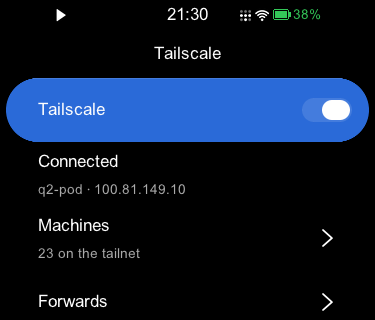
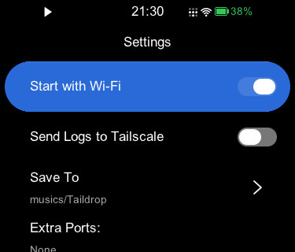

# q2-tailscale

Tailscale for the Shanling Q2 running [Q2 Pod](https://github.com/DiamondBond/q2-pod), as a card app.
It puts the Q2 on your tailnet, so the other apps on the Q2 (a Subsonic or Jellyfin client, the
browser, …) reach your machines by their MagicDNS names and Tailscale IPs: your home music server
from anywhere, with nothing opened to the internet.

| System settings → Network | The app's page | Settings |
|---|---|---|
|  |  |  |

Not an official Tailscale app. "Tailscale" is a trademark of Tailscale Inc.; this project is not
affiliated with or endorsed by Tailscale.

## What it does

- **Sign in with a QR code** on the Q2's screen: scan it with your phone, approve, done.
- **MagicDNS for every app.** The app runs a small name server on `127.0.0.1` and points the Q2's
  `/etc/resolv.conf` at it while it runs; tailnet names resolve, everything else goes to your Wi-Fi's
  DNS as before.
- **Your machines' Tailscale IPs work locally.** The Q2's kernel has no TUN, so Tailscale runs in
  userspace; the app adds your machines' IPs to the loopback interface and relays connections to them
  over the tailnet, on common ports (80, 443, Navidrome 4533, Jellyfin 8096/8920, Plex 32400) and any you
  add in Settings.
- **Forwards:** `127.0.0.1:<port>` to any machine's port, for apps that can't take a name.
- **Taildrop:** files sent to the Q2 from your phone or computer land in a folder on the card you
  choose.
- **Q2 apps on Tailscale:** open the page of an app running on the Q2, such as EQ Studio, from your
  phone or computer on another network (below). Off unless you turn it on.
- **Status bar icon:** connected, off or warning.
- **Follows Wi-Fi:** starts when Wi-Fi connects, stops when it goes (or only when you open it).

## Security

> [!IMPORTANT]
> **Update to q2-v0.3 or later.** Up to q2-v0.2, a device on the same Wi-Fi as the Q2 (a laptop on a
> café or hotel network, say) could send traffic for your machines' Tailscale IPs to the Q2 and reach
> them through it, as the Q2. q2-v0.3 relays only connections that come from the Q2 itself.

### What it protects

- **Your login stays off the card.** The node's keys are in the Q2's internal storage
  (`/mnt/data/apps/tailscale`), readable only by root. A card taken out, copied, or opened over USB or
  Wi-Fi transfer holds no way into your tailnet.
- **Nothing is opened to the local network.** The name server and your forwards listen on `127.0.0.1`
  only, and your machines' Tailscale IPs answer only programs on the Q2.
- **Nothing is served to your tailnet** but Taildrop, which takes files only from your own devices,
  and, if you turn on **Q2 Apps on Tailscale**, the pages of the apps running on the Q2, to your own
  devices only.
- **No logs leave the Q2** unless you turn on **Send Logs to Tailscale** in Settings. A tailnet that
  requires logs (network flow logs) won't connect without it; the page says so. The app's own log is in
  RAM (`/tmp/q2-tailscale.log`) and is gone at reboot.
- **Removing the app** with the App Store deletes the login too (the app does it itself, within a minute
  of being removed while it runs). **Sign Out** on the app's page ends the login as well.

### What it can't protect

- **Other apps, on older firmware.** Up to Q2 Pod 1.9.0 every card app runs as root, so any other app
  you install could read Tailscale's login: only install apps you trust. Newer firmware runs card apps
  without root, so they can't read it; Tailscale keeps root (`root=1`) to save its login and reach
  your machines.
- **What's on the card:** the app's settings, Taildrop's folder, and a cache of your tailnet's map (your
  machines' names and Tailscale IPs, DNS settings and access rules), with no keys. Anyone with the card
  can read that.
- **The Q2 reaches whatever your tailnet allows it to.** Any app on the Q2 can reach your machines'
  services through Tailscale.
- **A lost or stolen Q2 stays on your tailnet** until you remove it, or until its key expires and it needs
  a new sign-in.

### Suggestions

- **Lost or stolen Q2:** remove it in the [Tailscale admin console](https://login.tailscale.com/admin/machines)
  (Machines → the Q2 → Remove).
- **Limit what the Q2 can reach** with Tailscale's access rules: allow the Q2's Tailscale IP only your
  music server's port, such as Navidrome's 4533 or Jellyfin's 8096. (A tag would do it too, but a tagged
  Q2 no longer receives Taildrop from your devices.)
- **Keep key expiry on** for the Q2. Signing in again is a QR code scan.
- **Update the app** when the App Store offers an update.
- **Report a security problem** privately through this repository's
  [Security tab](https://github.com/js-surya/q2-tailscale/security/advisories/new), not in a public
  issue.

## Battery

The app follows the Wi-Fi link: it starts once Wi-Fi has an address and stops about 10 seconds after
the link is gone. It never keeps Wi-Fi on by itself, so with **Smart Wi-Fi** on (System settings →
Power) Wi-Fi goes off after 5 minutes without use and Tailscale stops with it. While Wi-Fi is on, it
asks no router for open ports (UPnP, NAT-PMP, PCP), so its traffic wakes the radio as little as it can.

- **SyncLink over Wi-Fi keeps Wi-Fi on all the time**, so Smart Wi-Fi never turns it off. If you don't
  control the Q2 from Shanling's app, turn it off in **System settings → Wireless → SyncLink**, below
  the Bluetooth switch (or set it to Bluetooth).
- Files sent with Taildrop arrive only while the Q2's Wi-Fi is on. Opening the app's page turns it on.
- Big Taildrop files: turn **Smart Wi-Fi** off until they arrive, or it may cut the transfer.

## Q2 apps on Tailscale

An app on the Q2 with a page, such as EQ Studio or File Browser, shows a QR code with its address on the
Q2's Wi-Fi, which a phone on another network can't reach. Turn on **Q2 Apps on Tailscale** in Settings,
and while such an app runs, its page is also at the Q2's Tailscale address, on the same port:
**Settings → Apps Shared Now** shows each one's address, such as `http://100.101.102.103:8020`. Open it
from a phone or computer with Tailscale on, then sign in with the PIN under the app's QR code.

- **Only your own devices** get through: those signed in to Tailscale as you. A tagged machine, or one
  shared to you from another tailnet, is refused. Each app still asks for its own PIN or key.
- Only apps running now are shared; one that stops is taken off.
- **Use HTTPS** serves them at the Q2's name with Tailscale's certificate instead, such as
  `https://q2-pod.tail1234.ts.net:8020`. It needs HTTPS turned on for your tailnet in the
  [admin console](https://login.tailscale.com/admin/dns) (DNS → HTTPS Certificates). The app gets the
  certificate when it starts; without HTTPS on, or if the certificate can't be had, the pages stay
  plain HTTP (which Tailscale encrypts anyway) and Apps Shared Now says why. The Q2's name goes into Tailscale's public
  certificate log, as every HTTPS name does. The first visit takes a few seconds while the certificate
  is fetched.
- Turn **Smart Wi-Fi** off while you use them from afar, or it may turn the Q2's Wi-Fi off.

## Developer option: q2remote over Tailscale

On a **developer build** of Q2 Pod (one with `q2remote`, its developer shell), Settings shows
**q2remote over Tailscale**, off unless you turn it on. On, the app passes connections to its Tailscale
address on q2remote's port (2302) to q2remote on the Q2, and nothing else, so a developer can reach their
Q2 from anywhere on their tailnet, even on a network that keeps devices apart (a university's, say).
q2remote still asks for its key. Release builds of Q2 Pod have no `q2remote`: the row never shows there,
and nothing is passed on.

Turn **Smart Wi-Fi** off while you work remotely, or it may cut the session.

## Undoing its changes

The app's changes to the system are made at start and undone at stop: its lines in `/etc/resolv.conf`
(a file in RAM on the Q2, marked `# q2-tailscale`) and the addresses it added to loopback. A reboot
clears both in any case.

## Install

**Requires Q2 Pod 1.9.0 or later.**

From the Q2: **System settings → App Store**. Or unzip a release's `q2-tailscale-vX.Y-SHA.zip` at the
root of the card. The app's row is in **System settings → Network**.

## Build

Needs Go (the version in `go.mod`) and python3:

```sh
contrib/shanlingq2/build.sh          # target/shanlingq2/.tailscale and the release zip
go test ./...
```

The binary is static Go for 32-bit little-endian MIPS (soft float), built with
[`tsnet`](https://pkg.go.dev/tailscale.com/tsnet); features the Q2 doesn't use are left out
(`contrib/shanlingq2/build-tags`).

## Credits

- [q2-subsonic](https://github.com/andsuor/q2-subsonic) by andsuor (MIT): the launcher, build and
  packaging scripts, Q2SPOT/1 framing and the QR encoder.
- [Tailscale](https://github.com/tailscale/tailscale) (BSD-3-Clause).
- [Q2 Pod](https://github.com/DiamondBond/q2-pod), the firmware this app runs on, by
  [DiamondBond](https://github.com/DiamondBond) and the Q2 Pod community.

See `NOTICE` and, in a release, `LICENSES.txt` for every licence in the binary.

## License

MIT. See `LICENSE`.
