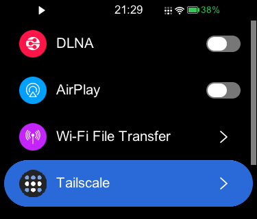

# q2-tailscale

Tailscale for the Shanling Q2 running [Q2 Pod](https://github.com/DiamondBond/q2-pod), as a card app.
It puts the Q2 on your tailnet, so the other apps on the Q2 (a Subsonic or Jellyfin client, the
browser, …) reach your machines by their MagicDNS names and Tailscale IPs: your home music server
from anywhere, with nothing opened to the internet.

| System settings → Network | The app's page | Settings |
|---|---|---|
|  |  |  |

Not an official Tailscale app. "Tailscale" is a trademark of Tailscale Inc.; this project is not
affiliated with or endorsed by Tailscale.

## What it does

- **Sign in with a QR code** on the Q2's screen: scan it with your phone, approve, done.
- **MagicDNS for every app.** The app runs a small name server on `127.0.0.1` and points the Q2's
  `/etc/resolv.conf` at it while it runs; tailnet names resolve, everything else goes to your Wi-Fi's
  DNS as before.
- **Your machines' Tailscale IPs work locally.** The Q2's kernel has no TUN, so Tailscale runs in
  userspace; the app adds your machines' IPs to the loopback interface and relays connections to them
  over the tailnet, on common ports (80, 443, Navidrome 4533, Jellyfin 8096/8920, Plex 32400) and any you
  add in Settings.
- **Forwards:** `127.0.0.1:<port>` to any machine's port, for apps that can't take a name.
- **Taildrop:** files sent to the Q2 from your phone or computer land in a folder on the card you
  choose.
- **Status bar icon:** connected, off or warning.
- **Follows Wi-Fi:** starts when Wi-Fi connects, stops when it goes (or only when you open it).

## Where your login is kept

The node's keys are kept in the Q2's internal storage (`/mnt/data/apps/tailscale`), readable only by
root, not on the card: a card taken out or copied holds no way into your tailnet. Removing the app with
the App Store deletes them too (the app does it itself, within a minute of being removed while it runs);
**Sign Out** on the app's page also ends the login.

Tailscale's own logs are off unless you turn on **Send Logs to Tailscale** in Settings. A tailnet that
requires logs (network flow logs) won't connect without it; the page says so.

## Battery

The app follows the Wi-Fi link: it starts once Wi-Fi has an address and stops about 10 seconds after
the link is gone. It never keeps Wi-Fi on by itself, so with **Smart Wi-Fi** on (System settings →
Power) Wi-Fi goes off after 5 minutes without use and Tailscale stops with it. While Wi-Fi is on, it
asks no router for open ports (UPnP, NAT-PMP, PCP), so its traffic wakes the radio as little as it can.

- **SyncLink over Wi-Fi keeps Wi-Fi on all the time**, so Smart Wi-Fi never turns it off. If you don't
  control the Q2 from Shanling's app, turn it off in **System settings → Wireless → SyncLink**, below
  the Bluetooth switch (or set it to Bluetooth).
- Files sent with Taildrop arrive only while the Q2's Wi-Fi is on. Opening the app's page turns it on.

## Undoing its changes

The app's changes to the system are made at start and undone at stop: its lines in `/etc/resolv.conf`
(a file in RAM on the Q2, marked `# q2-tailscale`) and the addresses it added to loopback. A reboot
clears both in any case.

## Install

**Requires Q2 Pod 1.9.0 or later.**

From the Q2: **System settings → App Store**. Or unzip a release's `q2-tailscale-vX.Y-SHA.zip` at the
root of the card. The app's row is in **System settings → Network**.

## Build

Needs Go (the version in `go.mod`) and python3:

```sh
contrib/shanlingq2/build.sh          # target/shanlingq2/.tailscale and the release zip
go test ./...
```

The binary is static Go for 32-bit little-endian MIPS (soft float), built with
[`tsnet`](https://pkg.go.dev/tailscale.com/tsnet); features the Q2 doesn't use are left out
(`contrib/shanlingq2/build-tags`).

## Credits

- [q2-subsonic](https://github.com/andsuor/q2-subsonic) by andsuor (MIT): the launcher, build and
  packaging scripts, Q2SPOT/1 framing and the QR encoder.
- [Tailscale](https://github.com/tailscale/tailscale) (BSD-3-Clause).
- [Q2 Pod](https://github.com/DiamondBond/q2-pod), the firmware this app runs on, by
  [DiamondBond](https://github.com/DiamondBond) and the Q2 Pod community.

See `NOTICE` and, in a release, `LICENSES.txt` for every licence in the binary.

## License

MIT. See `LICENSE`.
